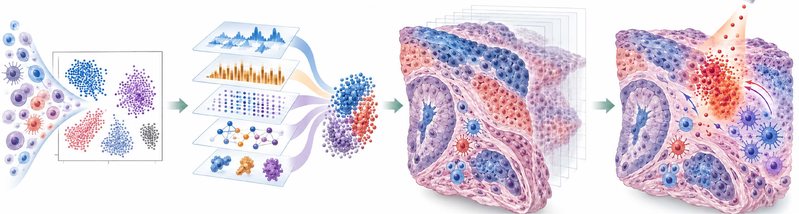

# Virtual Cell Lab

A curated guide to perturbation-response models, analysis methods, benchmarks, and datasets.

**Last checked: 3 November 2026.** Years use first online publication for journal articles, proceedings publication year for conference papers, and posting year for preprints. Preprints are labeled explicitly.

**Model names** link to primary papers or official proceedings. The **Code** column links to the official code repository.  

**Model structure** column links the published figure of each model's architecture.  

[Response prediction](#genetic-and-chemical-response-prediction) · [Spatial context and dynamics](#spatial-context-and-cellular-dynamics) · [Target discovery](#target-discovery-and-experimental-design) · [Analysis and applications](#perturbation-analysis-and-related-applications) · [Benchmarks](#benchmarks-and-challenges) · [Datasets](#perturbation-datasets) · [Single-cell foundation models](scFM/README.md)

## Interactive model architecture graph

**[Open the interactive graph →](https://xianglin226.github.io/Benchmarking-Single-Cell-Perturbation/architecture_graph/architecture_network.html)**

Explore 77 perturbation methods by shared architecture, select a method to inspect its neighbors, and filter edges by similarity. Edges reflect curated architecture tags, not measured predictive performance; dashed edges share modules only.

## Genetic and chemical response prediction

| Model | Year | Publication / status | Features and scope | model structure | Code |
| :--- | :---: | :--- | :--- | :--- | :---: |
| [Hodos et al.](https://psb.stanford.edu/psb-online/proceedings/psb18/hodos.pdf) | 2018 | PSB 2018 | Bulk expression: nearest-neighbor prediction and tensor completion for unmeasured drug–cell-type profiles. | [kNN / tensor completion](model_figures/Hodos_et_al._Architecture_Figure2.png) | — |
| [scGen](https://www.nature.com/articles/s41592-019-0494-8) | 2019 | Nature Methods | VAE latent-space vector arithmetic transfers perturbation effects to held-out cell populations. | [VAE](model_figures/scGen_Figure1.png) | [GitHub](https://github.com/theislab/scgen) |
| [CellBox](https://doi.org/10.1016/j.cels.2020.11.013) | 2020 | Cell Systems | Interpretable dynamical network model of signaling and viability responses, used to design cancer drug combinations. | [ODE network](model_figures/CellBox_Figure1.jpg) | [GitHub](https://github.com/sanderlab/CellBox) |
| [chemCPA](https://proceedings.neurips.cc/paper_files/paper/2022/hash/aa933b5abc1be30baece1d230ec575a7-Abstract-Conference.html) | 2022 | NeurIPS 2022 | Chemical-structure embeddings extend a compositional autoencoder to predict responses to unseen drugs. | [Compositional autoencoder](model_figures/chemCPA_Figure1.png) | [GitHub](https://github.com/theislab/chemCPA) |
| [MultiCPA](https://icml-compbio.github.io/2022/papers/WCBICML2022_paper_50.pdf) | 2022 | ICML 2022 Computational Biology Workshop | Compositional latent modeling of multimodal perturbation responses, including unseen combinations of measured interventions. | [Compositional autoencoder](model_figures/MultiCPA_Figure1.png) | [GitHub](https://github.com/theislab/multicpa) |
| [scPreGAN](https://academic.oup.com/bioinformatics/article/38/13/3377/6593485) | 2022 | Bioinformatics | Combines an autoencoder with adversarial generation to predict perturbed single-cell expression distributions. | Autoencoder + GAN (figure unavailable) | [GitHub](https://github.com/XiajieWei/scPreGAN) |
| [CellOT](https://www.nature.com/articles/s41592-023-01969-x) | 2023 | Nature Methods | Learns neural optimal-transport maps between unpaired control and treated cell distributions; fits a map per perturbation. | [Neural optimal transport](model_figures/CellOT_Figure1.png) | [GitHub](https://github.com/bunnech/cellot) |
| [CPA](https://www.embopress.org/doi/full/10.15252/msb.202211517) | 2023 | Molecular Systems Biology | Disentangles basal state, perturbations, and covariates; composes latent effects to predict doses and perturbation combinations. | [Compositional autoencoder](model_figures/CPA_Figure1.jpg) | [GitHub](https://github.com/theislab/cpa) |
| [GEARS](https://www.nature.com/articles/s41587-023-01905-6) | 2023 | Nature Biotechnology | GO-derived perturbation graphs and coexpression graphs support prediction of unseen genetic perturbations and combinations. | [GNN](model_figures/GEARS_Figure1.png) | [GitHub](https://github.com/snap-stanford/GEARS) |
| [ontoVAE](https://academic.oup.com/bioinformatics/article/39/6/btad387/7199588) | 2023 | Bioinformatics | Ontology-structured VAE decoder yields interpretable pathway activities and supports in silico genetic/drug perturbations. | [Ontology-informed VAE](model_figures/ontoVAE_Figure1.jpg) | [GitHub](https://github.com/hdsu-bioquant/onto-vae) |
| [SAMS-VAE](https://proceedings.neurips.cc/paper_files/paper/2023/hash/0001ca33ba34ce0351e4612b744b3936-Abstract-Conference.html) | 2023 | NeurIPS 2023 | Sparse additive perturbation embeddings compose with basal cell states in a VAE for response modeling. | [Sparse additive VAE](model_figures/SAMS-VAE_Figure1.png) | [GitHub](https://github.com/insitro/sams-vae) |
| [scDiff](https://www.biorxiv.org/content/10.1101/2023.10.13.562243v1.abstract) | 2023 | bioRxiv preprint | Conditional diffusion framework for multiple single-cell tasks, including perturbation-response prediction. | [Conditional diffusion](model_figures/scDiff_Figure1.png) | [GitHub](https://github.com/OmicsML/scDiff) |
| [scVIDR](https://www.cell.com/patterns/pdf/S2666-3899(23)00186-1.pdf) | 2023 | Patterns | VAE with cell-type-specific latent response vectors and dose interpolation for chemical perturbations. | [VAE](model_figures/scVIDR_Figure1.jpg) | [GitHub](https://github.com/BhattacharyaLab/scVIDR) |
| [biolord](https://www.nature.com/articles/s41587-023-02079-x) | 2024 | Nature Biotechnology | Disentangles known attributes from residual cell variation and generates counterfactuals by changing attribute embeddings. | [Disentangled latent model](model_figures/biolord_Figure1.png) | [GitHub](https://github.com/nitzanlab/biolord) |
| [CODEX](https://academic.oup.com/bioinformatics/article/40/Supplement_1/i91/7700898) | 2024 | Bioinformatics | Counterfactual deep learning predicts cancer-cell-line responses to unseen intervention combinations and can incorporate GO priors. | [Counterfactual neural network](model_figures/CODEX_Figure1.jpg) | [GitHub](https://github.com/sschrod/CODEX) |
| [cycleCDR](https://doi.org/10.1093/bioinformatics/btae248) | 2024 | Bioinformatics | Uses cycle-consistency constraints for bidirectional control–perturbed state mapping; evaluated on chemical and genetic responses. | [Cycle-consistent network](model_figures/cycleCDR_Figure1.jpg) | [GitHub](https://github.com/hliulab/cycleCDR) |
| [PRnet](https://www.nature.com/articles/s41467-024-53457-1) | 2024 | Nature Communications | Conditions on compound structure and baseline expression to generate chemical responses at bulk and single-cell resolution. | [Conditional encoder–decoder](model_figures/PRnet_Figure1.png) | [GitHub](https://github.com/Perturbation-Response-Prediction/PRnet) |
| [scDisInFact](https://www.nature.com/articles/s41467-024-45227-w) | 2024 | Nature Communications | Disentangled VAE separates shared biology, condition-specific factors, and batch effects for integration and condition-response prediction. | [Disentangled VAE](model_figures/scDisInFact_Figure1.png) | [GitHub](https://github.com/ZhangLabGT/scDisInFact) |
| [scLAMBDA](https://doi.org/10.1101/2024.12.04.626878) | 2024 | bioRxiv preprint | VAE with language-model-derived gene embeddings separates basal and perturbation-specific representations for single/multi-gene prediction. | [VAE](model_figures/scLAMBDA_Figure1.jpg) | [GitHub](https://github.com/gefeiwang/scLAMBDA) |
| [STAMP](https://www.nature.com/articles/s43588-024-00698-1) | 2024 | Nature Computational Science | Decomposes genetic-response prediction into differential-expression detection, change direction, and change magnitude. | [Multi-task neural network](model_figures/STAMP_Figure1.png) | [GitHub](https://github.com/bm2-lab/STAMP) |
| [TranSiGen](https://www.nature.com/articles/s41467-024-49620-3) | 2024 | Nature Communications | Self-supervised generative representations combine baseline expression and molecular structure to reconstruct chemical-induced transcriptional profiles. | [Dual VAE](model_figures/TranSiGen_Figure1.png) | [GitHub](https://github.com/myzhengSIMM/TranSiGen) |
| [CausalGRN](https://www.biorxiv.org/content/10.64898/2025.12.30.692369v1.abstract) | 2025 | bioRxiv preprint | Infers a network skeleton, orients edges using CRISPR effects, and predicts downstream responses through the directed regulatory network. | [Causal regulatory network](model_figures/CausalGRN_Figure1.png) | [GitHub](https://github.com/yub-hutch/CausalGRN) |
| [CellFlow](https://www.biorxiv.org/content/10.1101/2025.04.11.648220v1) | 2025 | bioRxiv preprint | Conditional flow matching generates cell-phenotype distributions for chemical, genetic, and signaling perturbations. | [Flow matching](model_figures/CellFlow_Figure1.png) | [GitHub](https://github.com/theislab/CellFlow) |
| [Cradle-VAE](https://ojs.aaai.org/index.php/AAAI/article/view/33695) | 2025 | AAAI 2025 | Counterfactual artifact disentanglement separates technical effects from biological perturbation signals in a causal generative VAE. | [Causal VAE](model_figures/Cradle-VAE_Figure1.png) | [GitHub](https://github.com/dmis-lab/CRADLE-VAE) |
| [GPerturb](https://www.nature.com/articles/s41467-025-61165-7) | 2025 | Nature Communications | Sparse Gaussian-process regression models gene-level perturbation effects and provides uncertainty estimates, including for dose responses. | [Gaussian process](model_figures/GPerturb_Figure1.png) | [GitHub](https://github.com/hwxing3259/GPerturb) |
| [IMPA](https://www.nature.com/articles/s41467-024-55707-8) | 2025 | Nature Communications | Conditional adversarial autoencoder transfers perturbation style to control-cell images to generate morphological responses. | [Adversarial autoencoder](model_figures/IMPA_Figure1.png) | [GitHub](https://github.com/theislab/IMPA) |
| [PerturbNet](https://doi.org/10.1038/s44320-025-00131-3) | 2025 | Molecular Systems Biology | Conditional normalizing flows link perturbation representations to cell-state distributions for unseen chemicals, gene interventions, and coding variants. | [Conditional normalizing flow](model_figures/PerturbNet_Figure1.png) | [GitHub](https://github.com/welch-lab/PerturbNet) |
| [PRESAGE](https://doi.org/10.1101/2025.06.03.657653) | 2025 | bioRxiv preprint | Attention-based integration of diverse gene embeddings predicts expression responses to unmeasured genetic perturbations. | [Attention network](model_figures/PRESAGE_Figure1.png) | [GitHub](https://github.com/genentech/PRESAGE) |
| [Scouter](https://www.nature.com/articles/s43588-025-00912-8) | 2025 | Nature Computational Science | Uses LLM-derived gene embeddings and a compressor–generator network to predict unseen genetic perturbation responses. | [Compressor–generator network](model_figures/Scouter_Figure1.png) | [GitHub](https://github.com/PancakeZoy/scouter) |
| [Squidiff](https://www.nature.com/articles/s41592-025-02877-y) | 2025 | Nature Methods | Diffusion-based generation models cell development and transcriptomic responses to perturbations. | [Conditional diffusion](model_figures/Squidiff_Figure1.jpg) | [GitHub](https://github.com/siyuh/Squidiff) |
| [Conditional Monge Gap](https://doi.org/10.1038/s42256-026-01242-8) | 2026 | Nature Machine Intelligence | Conditional optimal transport models drug-, dose-, and combination-dependent single-cell response distributions. | [Conditional optimal transport](model_figures/Conditional_Monge_Gap_Figure1.png) | [GitHub](https://github.com/AI4SCR/conditional-monge-gap) |
| [CSTATE](https://doi.org/10.1145/3807503.3819991) | 2026 | ACM BCB 2026 | Structural causal modeling over latent gene modules estimates intervention effects conditional on cellular context. | Structural causal model (figure unavailable) | — |
| [LCD](https://doi.org/10.1073/pnas.2602630123) | 2026 | PNAS | Latent causal diffusion models gene-regulatory dynamics and unseen perturbation combinations; CLIPR interprets direct causal effects. | [Latent causal diffusion](model_figures/LCD_Figure1.png) | [GitHub](https://github.com/larslorch/lcd-clipr) |
| [MultiPert](https://doi.org/10.1371/journal.pcbi.1014054) | 2026 | PLOS Computational Biology | Adversarial alignment and dual attention model perturbation responses across single-cell omics modalities. | [Autoencoder + dual attention](model_figures/MultiPert_Figure1.png) | [GitHub](https://github.com/MengyuanZhaoo/MultiPert) |
| [PertAdapt](https://doi.org/10.1093/bioinformatics/btag307) | 2026 | Bioinformatics | Adds a perturbation-conditioned adapter and adaptive loss to foundation models for genetic-response prediction. | [Foundation-model adapter](model_figures/PertAdapt_Figure1.jpg) | [GitHub](https://github.com/BaiDing1234/PertAdapt) |
| [PerturbDiff](https://proceedings.mlr.press/v306/yuan26d.html) | 2026 | ICML 2026 | Functional diffusion operates on population distributions to model hidden-context variation in perturbation responses. | [Functional diffusion](model_figures/PerturbDiff_Architecture_Figure2.png) | [GitHub](https://github.com/DeepGraphLearning/PerturbDiff) |
| [PerturbLDM](https://doi.org/10.64898/2026.08.07.743610) | 2026 | bioRxiv preprint | Conditional latent diffusion generates single-cell responses in specified drug and cellular contexts. | [Latent diffusion](model_figures/PerturbLDM_Figure1.png) | [GitHub](https://github.com/davidroad/PerturbLDM) |
| [PopPert](https://arxiv.org/abs/2609.01357) | 2026 | arXiv preprint | Models population-level joint expression distributions with a low-rank Gaussian copula, including cross-gene dependencies. | [Gaussian copula](model_figures/PopPert_Architecture_Figure2.png) | [GitHub](https://github.com/whd1125/PopPert) |
| [PrePR-CT](https://www.nature.com/articles/s42256-026-01202-2) | 2026 | Nature Machine Intelligence | Cell-type-specific graphs and inductive biological priors support interpretable drug-response prediction in limited-data settings. | [Graph attention network](model_figures/PrePR-CT_Figure1.png) | [GitHub](https://github.com/reem12345/Cell-Type-Specific-Graphs) |
| [scBalFlow](https://doi.org/10.1093/bioinformatics/btag682) | 2026 | Bioinformatics | Staged flow matching separates response-intensity prediction from expression generation to address imbalanced drug responses. | [Staged flow matching](model_figures/scBalFlow_Architecture_Figure2.webp) | [GitHub](https://github.com/hanwenlv-cmd/scBalFlow) |
| [scDFM](https://proceedings.iclr.cc/paper_files/paper/2026/hash/75f029a1289a47aa99c86588239f0c12-Abstract-Conference.html) | 2026 | ICLR 2026 | Conditional flow matching with population-distribution alignment predicts genetic and chemical responses from unpaired cell populations. | [Flow matching](model_figures/scDFM_Figure1.png) | [GitHub](https://github.com/AI4Science-WestlakeU/scDFM) |
| [scDRP](https://doi.org/10.1093/bib/bbag482) | 2026 | Briefings in Bioinformatics | Disentangles perturbation-dependent response from cell identity to estimate heterogeneous individual treatment effects. | [VAE + optimal transport](model_figures/scDRP_Figure1.webp) | [GitHub](https://github.com/sjl-sjtu/scDRP) |
| [scLDM](https://doi.org/10.1093/bioinformatics/btag727) | 2026 | Bioinformatics | VAE compression and conditional latent diffusion generate responses conditioned on baseline cell state, cell type, and perturbation. | [VAE + latent diffusion](model_figures/scLDM_Figure1.webp) | [GitHub](https://github.com/samrogers1233/scLDM) |
| [scPert](https://www.biorxiv.org/content/10.64898/2026.04.24.720560v1.abstract) | 2026 | bioRxiv preprint | Transformer fuses LLM-derived gene embeddings with structured biological knowledge for single and combinatorial genetic-response prediction. | [Transformer](model_figures/scPert_Figure1.png) | [GitHub](https://github.com/AI4VirtualCell/scPert) |
| [Stack](https://www.biorxiv.org/content/10.64898/2026.01.09.698608v1) | 2026 | bioRxiv preprint | Cell-set foundation model uses prompt cells for in-context, counterfactual expression generation across cellular conditions. | [Cell-set transformer](model_figures/Stack_Figure1.jpg) | [GitHub](https://github.com/ArcInstitute/stack) |
| [STATE](https://doi.org/10.1016/j.cell.2026.07.052) | 2026 | Cell | Set-based transition model predicts context-dependent perturbation responses; observationally pretrained embeddings provide complementary cell-state information. | [Set transformer](model_figures/STATE_Figure1.jpg) | [GitHub](https://github.com/ArcInstitute/state) |
| [TxPert](https://www.nature.com/articles/s41587-026-03113-4) | 2026 | Nature Biotechnology | Latent transfer integrates multiple gene-interaction knowledge graphs to predict genetic perturbation effects and cross-context responses. | [GNN + encoder–decoder](model_figures/TxPert_Architecture_Figure2.png) | [GitHub](https://github.com/valence-labs/TxPert) |
| [UniPert-G2CP](https://www.sciencedirect.com/science/article/pii/S0092867426006549) | 2026 | Cell | Unifies genetic and chemical molecular representations, then transfers genetic-screen information to chemical phenotype prediction. | [Multimodal neural encoder](model_figures/UniPert-G2CP_Figure1.jpg) | [GitHub](https://github.com/TencentAILabHealthcare/UniPert) |
| [X-Cell](https://www.biorxiv.org/content/10.64898/2026.03.18.712807v1.abstract) | 2026 | bioRxiv preprint | Diffusion language model uses multimodal biological priors to predict genetic perturbation responses across cellular contexts. | [Diffusion language model](model_figures/X-Cell_Figure1.png) | [GitHub](https://github.com/Xaira-Therapeutics/X-Cell) |
| [XPert](https://www.nature.com/articles/s42256-025-01165-w) | 2026 | Nature Machine Intelligence | Biologically informed dual-branch transformer models baseline expression, drug-induced changes, and dose/time dependence. | [Dual-branch transformer](model_figures/XPert_Figure1.png) | [GitHub](https://github.com/GSanShui/XPert) |

## Spatial context and cellular dynamics

| Model | Year | Publication / status | Features and scope | model structure | Code |
| :--- | :---: | :--- | :--- | :--- | :---: |
| [CellDrift](https://academic.oup.com/bib/article/23/5/bbac324/6673850) | 2022 | Briefings in Bioinformatics | Generalized linear models and functional data analysis identify temporal perturbation-response patterns across cell types. | [GLM / functional analysis](model_figures/CellDrift_Figure1.jpg) | [GitHub](https://github.com/KANG-BIOINFO/CellDrift) |
| [CONCERT](https://www.biorxiv.org/content/10.1101/2025.11.08.686890v2.abstract) | 2025 | bioRxiv preprint | Disentangles perturbation/state attributes and learns spatial Gaussian-process kernels for niche-aware counterfactual response prediction. | [GP-VAE](model_figures/CONCERT_Architecture_Figure2.jpg) | [GitHub](https://github.com/mims-harvard/CONCERT) |
| [UNAGI](https://doi.org/10.1038/s41551-025-01423-7) | 2025 | Nature Biomedical Engineering | Learns disease-associated cellular dynamics and performs in silico gene/pathway/drug interventions for drug discovery and repurposing. | [VAE-GAN + GCN](model_figures/UNAGI_Figure1.png) | [GitHub](https://github.com/mcgilldinglab/UNAGI) |
| [AlphaCell](https://www.biorxiv.org/content/10.64898/2026.03.02.709176v1.abstract) | 2026 | bioRxiv preprint | World-model framework for simulating perturbation-induced cellular dynamics; described in a preprint. | [World-model framework](model_figures/AlphaCell_Figure1.png) | — |
| [Celcomen](https://doi.org/10.1038/s41467-026-69856-5) | 2026 | Nature Communications | Causal graph modeling separates intra- and inter-cellular regulation to generate counterfactual spatial transcriptomics. | [Causal graph model](model_figures/Celcomen_Figure1.png) | [GitHub](https://github.com/Teichlab/celcomen) |
| [RegVelo](https://www.cell.com/cell/fulltext/S0092-8674(26)00457-5) | 2026 | Cell | Couples splicing kinetics with gene-regulatory interactions; supports in silico regulatory perturbation and cell-fate analysis. | [VAE + neural ODE](model_figures/RegVelo_Figure1.jpg) | [GitHub](https://github.com/theislab/regvelo) |

## Target discovery and experimental design

| Model | Year | Publication / status | Features and scope | model structure | Code |
| :--- | :---: | :--- | :--- | :--- | :---: |
| [BioDiscoveryAgent](https://proceedings.iclr.cc/paper_files/paper/2025/hash/4252dc94531833029000f85dc5fac792-Abstract-Conference.html) | 2025 | ICLR | LLM agent designs genetic perturbation experiments using biological knowledge and observed outcomes; experimental design rather than expression generation. | [LLM agent](model_figures/BioDiscoveryAgent_Figure1.png) | [GitHub](https://github.com/snap-stanford/BioDiscoveryAgent) |
| [PDGrapher](https://www.nature.com/articles/s41551-025-01481-x) | 2025 | Nature Biomedical Engineering | Inverse design: causally inspired graph networks propose therapeutic target combinations to move a diseased state toward a treated state. | [GNN](model_figures/PDGrapher_Figure1.png) | [GitHub](https://github.com/mims-harvard/PDGrapher) |
| [SequenTx](https://www.nature.com/articles/s42256-026-01192-1) | 2026 | Nature Machine Intelligence | Combines a tumour cell-state model with reinforcement learning to design sequential drug treatments. | [Neural model + RL](model_figures/SequenTx_Figure1.png) | [GitHub](https://github.com/DELTA-TJ/SequenTx) |

## Perturbation analysis and related applications

| Model | Year | Publication / status | Features and scope | model structure | Code |
| :--- | :---: | :--- | :--- | :--- | :---: |
| [DTD](https://dl.acm.org/doi/abs/10.1145/3308558.3313476) | 2019 | The Web Conference 2019 | Drug–target–disease association prediction by relational tensor factorization; not a single-cell response generator. | Tensor factorization (figure unavailable) | — |
| [scINSIGHT](https://doi.org/10.1186/s13059-022-02649-3) | 2022 | Genome Biology | Matrix factorization separates shared and condition-specific gene programs; an integration/interpretation method, not a response predictor. | [Matrix factorization](model_figures/scINSIGHT_Figure1.png) | [GitHub](https://github.com/Vivianstats/scINSIGHT) |
| [CINEMA-OT](https://www.nature.com/articles/s41592-023-02040-5) | 2023 | Nature Methods | Separates treatment-associated signals from confounders and uses optimal transport to estimate single-cell treatment effects. | [ICA + optimal transport](model_figures/CINEMA-OT_Figure1.png) | [GitHub](https://github.com/vandijklab/CINEMA-OT) |
| [contrastiveVI](https://www.nature.com/articles/s41592-023-01955-3) | 2023 | Nature Methods | Separates target-specific variation from variation shared with background/control cells; a contrastive analysis model. | [Contrastive VAE](model_figures/contrastiveVI_Figure1.png) | [GitHub](https://github.com/suinleelab/contrastiveVI) |
| [DREEP](https://link.springer.com/article/10.1186/s12916-023-03182-1) | 2023 | BMC Medicine | Uses pharmacogenomic sensitivity signatures and enrichment to estimate drug vulnerability from tumour-cell expression; not transcriptome generation. | [Signature enrichment](model_figures/DREEP_Figure1.png) | [GitHub](https://github.com/gambalab/DREEP) |
| [MOASL](https://www.sciencedirect.com/science/article/abs/pii/S0010482523013185) | 2023 | Computers in Biology and Medicine | Contrastive similarity learning predicts drug mechanisms of action from transcriptomic signatures. | [Contrastive neural network](model_figures/MOASL_Figure1.jpg) | [GitHub](https://github.com/jianglikun/MOASL) |
| [sVAE](https://proceedings.mlr.press/v213/lopez23a.html) | 2023 | CLeaR 2023 (PMLR 213) | Models perturbations as sparse interventions on latent mechanisms to learn interpretable cellular representations. | [Sparse VAE](model_figures/sVAE_Figure1.png) | [GitHub](https://github.com/Genentech/sVAE) |
| [Cell Painting CNN](https://www.nature.com/articles/s41467-024-45999-1) | 2024 | Nature Communications | Weakly supervised CNN learns morphological profiles from Cell Painting images; represents observed phenotypes rather than generating responses. | [CNN](model_figures/Cell_Painting_CNN_Figure1.png) | [GitHub](https://github.com/broadinstitute/DeepProfilerExperiments) |
| [DRSPRING](https://www.sciencedirect.com/science/article/pii/S0010482524005201) | 2024 | Computers in Biology and Medicine | GCN integrates chemical, interaction, and expression information to predict drug-pair synergy; endpoint is synergy, not cell-state generation. | [GCN](model_figures/DRSPRING_Figure1.jpg) | [GitHub](https://github.com/sommerJY/DRSPRING) |
| [PertKGE](https://doi.org/10.1016/j.xgen.2024.100655) | 2024 | Cell Genomics | Knowledge-graph embedding of perturbation transcriptomics infers compound–protein interactions for target identification and virtual screening. | [Knowledge-graph embeddings](model_figures/PertKGE_Figure1.jpg) | [GitHub](https://github.com/myzhengSIMM/PertKGE) |
| [SC-VAE](https://proceedings.mlr.press/v240/tu24a.html) | 2024 | MLCB 2023 (proceedings 2024) | Guide-supervised contrastive VAE separates perturbation effects from baseline heterogeneity for perturbation interpretation. | [Contrastive VAE](model_figures/SC-VAE_Figure1.png) | — |
| [scRank](https://www.cell.com/cell-reports-medicine/fulltext/S2666-3791(24)00260-X) | 2024 | Cell Reports Medicine | Perturbs cell-type-specific regulatory networks in silico to rank drug-responsive populations from untreated scRNA-seq. | [Regulatory-network model](model_figures/scRank_Figure1.jpg) | [GitHub](https://github.com/ZJUFanLab/scRank) |
| [TAT](https://pubs.acs.org/doi/full/10.1021/acs.jcim.3c01855) | 2024 | Journal of Chemical Information and Modeling | Transformer maps dose-dependent transcriptional profiles to compound activity in other assays; not a transcriptome-response generator. | [Transformer](model_figures/TAT_Architecture_Figure2.png) | — |
| [CellCap](https://doi.org/10.1016/j.cels.2025.101245) | 2025 | Cell Systems | Sparse response programs and attention model how basal cell state shapes heterogeneous perturbation responses. | [VAE + attention](model_figures/CellCap_Figure1.jpg) | [GitHub](https://github.com/broadinstitute/CellCap) |
| [Pertpy](https://www.nature.com/articles/s41592-025-02909-7) | 2025 | Nature Methods | Modular perturbation-analysis toolkit covering datasets, annotations, distances, and statistical analyses; not one predictive model. | [Analysis toolkit](model_figures/Pertpy_Figure1.png) | [GitHub](https://github.com/scverse/pertpy) |
| [PS](https://www.nature.com/articles/s41556-025-01626-9) | 2025 | Nature Cell Biology | Estimates continuous per-cell perturbation strength from downstream expression changes to resolve heterogeneous responses. | [Constrained regression](model_figures/PS_Figure1.png) | [GitHub](https://github.com/davidliwei/PS) |
| [scAgents](https://openreview.net/forum?id=HGJQvwGtfJ) | 2025 | OpenReview submission | Multi-agent analysis framework generates models and executable workflows for single-cell perturbation tasks; not one fixed predictor. | LLM multi-agent framework (figure unavailable) | — |
| [TRADE](https://www.nature.com/articles/s41588-025-02169-3) | 2025 | Nature Genetics | Statistical model estimates the distribution and transcriptome-wide impact of differential-expression effects while accounting for estimation error. | [Statistical effect model](model_figures/TRADE_Figure1.png) | [GitHub](https://github.com/ajaynadig/TRADEtools) |

scAgents is retained as an OpenReview submission; workshop formatting alone was not treated as confirmation of acceptance.

## Benchmarks and challenges

| Benchmark / study | Year | Publication / status | Features and scope | Code |
| :--- | :---: | :--- | :--- | :---: |
| [Foundation-model benchmark](https://link.springer.com/article/10.1186/s12864-025-11600-2) | 2025 | BMC Genomics | Benchmarks foundation cell models for predicting post-perturbation RNA-seq profiles. | [GitHub](https://github.com/turbine-ai/PerturbSeqPredBenchmark) |
| [Linear-baseline benchmark](https://www.nature.com/articles/s41592-025-02772-6) | 2025 | Nature Methods | Tests deep genetic-response predictors against simple linear baselines across evaluation settings. | [GitHub](https://github.com/const-ae/linear_perturbation_prediction-Paper) |
| [Network-inference benchmark](https://www.nature.com/articles/s42003-025-07764-y) | 2025 | Communications Biology | Benchmarks regulatory-network inference using large-scale single-cell perturbation data. | [GitHub](https://github.com/causalbench/causalbench) |
| [PertEval-scFM](https://proceedings.mlr.press/v267/wenteler25a.html) | 2025 | ICML | Benchmark framework tests whether zero-shot foundation-model embeddings improve perturbation-effect prediction; not a response model. | [GitHub](https://github.com/aaronwtr/PertEval) |
| [PerturBench](https://proceedings.neurips.cc/paper_files/paper/2025/file/8aee537279a66ced96319dfca3c00002-Paper-Datasets_and_Benchmarks_Track.pdf) | 2025 | NeurIPS 2025 | Provides datasets, data splits, metrics, and a modeling framework for reproducible perturbation benchmarks. | [GitHub](https://github.com/altoslabs/perturbench) |
| [Simple-controls benchmark](https://academic.oup.com/bioinformatics/article/41/6/btaf317/8142305) | 2025 | Bioinformatics | Evaluates simple controls and foundation-model representations for genetic perturbation prediction. | [GitHub](https://github.com/pfizer-opensource/perturb_seq) |
| [Systema](https://www.nature.com/articles/s41587-025-02777-8) | 2025 | Nature Biotechnology | Evaluation framework separates perturbation-specific predictive signal from systematic variation and baseline effects. | [GitHub](https://github.com/mlbio-epfl/systema) |

## Review

| Year | Publication | Review |
| :---: | :--- | :--- |
| 2026 | Nature Reviews Genetics | [Interpretation, extrapolation and perturbation of single cells](https://www.nature.com/articles/s41576-025-00920-4) |

Full paper titles and sources

| Entry | Paper title |
| :--- | :--- |
| AlphaCell | [Towards building a World Model to simulate perturbation-induced cellular dynamics by AlphaCell](https://www.biorxiv.org/content/10.64898/2026.03.02.709176v1.abstract) |
| BioDiscoveryAgent | [BioDiscoveryAgent: An AI Agent for Designing Genetic Perturbation Experiments](https://proceedings.iclr.cc/paper_files/paper/2025/hash/4252dc94531833029000f85dc5fac792-Abstract-Conference.html) |
| biolord | [Disentanglement of single-cell data with biolord](https://www.nature.com/articles/s41587-023-02079-x) |
| CausalGRN | [CausalGRN: deciphering causal gene regulatory networks from single-cell CRISPR screens](https://www.biorxiv.org/content/10.64898/2025.12.30.692369v1.abstract) |
| Celcomen | [Celcomen: spatial causal disentanglement for single-cell and tissue perturbation modeling](https://doi.org/10.1038/s41467-026-69856-5) |
| Cell Painting CNN | [Learning representations for image-based profiling of perturbations](https://www.nature.com/articles/s41467-024-45999-1) |
| CellBox | [CellBox: Interpretable Machine Learning for Perturbation Biology with Application to the Design of Cancer Combination Therapy](https://doi.org/10.1016/j.cels.2020.11.013) |
| CellCap | [Explainable modeling of single-cell perturbation data using attention and sparse dictionary learning](https://doi.org/10.1016/j.cels.2025.101245) |
| CellDrift | [CellDrift: inferring perturbation responses in temporally sampled single-cell data](https://academic.oup.com/bib/article/23/5/bbac324/6673850) |
| CellFlow | [CellFlow enables generative single-cell phenotype modeling with flow matching](https://www.biorxiv.org/content/10.1101/2025.04.11.648220v1) |
| CellOT | [Learning single-cell perturbation responses using neural optimal transport](https://www.nature.com/articles/s41592-023-01969-x) |
| chemCPA | [Predicting Cellular Responses to Novel Drug Perturbations at a Single-Cell Resolution](https://proceedings.neurips.cc/paper_files/paper/2022/hash/aa933b5abc1be30baece1d230ec575a7-Abstract-Conference.html) |
| CINEMA-OT | [Causal identification of single-cell experimental perturbation effects with CINEMA-OT](https://www.nature.com/articles/s41592-023-02040-5) |
| CODEX | [CODEX: COunterfactual Deep learning for the in silico EXploration of cancer cell line perturbations](https://academic.oup.com/bioinformatics/article/40/Supplement_1/i91/7700898) |
| CONCERT | [CONCERT predicts niche-aware perturbation responses in spatial transcriptomics](https://www.biorxiv.org/content/10.1101/2025.11.08.686890v2.abstract) |
| Conditional Monge Gap | [Conditional Monge Gap enables generalizable single-cell perturbation modelling](https://doi.org/10.1038/s42256-026-01242-8) |
| contrastiveVI | [Isolating salient variations of interest in single-cell data with contrastiveVI](https://www.nature.com/articles/s41592-023-01955-3) |
| CPA | [Predicting cellular responses to complex perturbations in high‐throughput screens](https://www.embopress.org/doi/full/10.15252/msb.202211517) |
| Cradle-VAE | [Cradle-VAE: Enhancing Single-Cell Gene Perturbation Modeling with Counterfactual Reasoning-based Artifact Disentanglement](https://ojs.aaai.org/index.php/AAAI/article/view/33695) |
| CSTATE | [CSTATE: Predicting cellular responses to perturbations](https://doi.org/10.1145/3807503.3819991) |
| cycleCDR | [Predicting single-cell cellular responses to perturbations using cycle consistency learning](https://doi.org/10.1093/bioinformatics/btae248) |
| DREEP | [Predicting drug response from single-cell expression profiles of tumours](https://link.springer.com/article/10.1186/s12916-023-03182-1) |
| DRSPRING | [DRSPRING: Graph convolutional network (GCN)-Based drug synergy prediction utilizing drug-induced gene expression profile](https://www.sciencedirect.com/science/article/pii/S0010482524005201) |
| DTD | [Modeling Relational Drug-Target-Disease Interactions via Tensor Factorization with Multiple Web Sources](https://dl.acm.org/doi/abs/10.1145/3308558.3313476) |
| Foundation-model benchmark | [Benchmarking foundation cell models for post-perturbation RNA-seq prediction](https://link.springer.com/article/10.1186/s12864-025-11600-2) |
| GEARS | [Predicting transcriptional outcomes of novel multigene perturbations with GEARS](https://www.nature.com/articles/s41587-023-01905-6) |
| GPerturb | [GPerturb: Gaussian process modelling of single-cell perturbation data](https://www.nature.com/articles/s41467-025-61165-7) |
| Hodos et al. | [Cell-specific prediction and application of drug-induced gene expression profiles](https://psb.stanford.edu/psb-online/proceedings/psb18/hodos.pdf) |
| IMPA | [Predicting cell morphological responses to perturbations using generative modeling](https://www.nature.com/articles/s41467-024-55707-8) |
| LCD | [Latent causal diffusions for single-cell perturbation modeling](https://doi.org/10.1073/pnas.2602630123) |
| Linear-baseline benchmark | [Deep-learning-based gene perturbation effect prediction does not yet outperform simple linear baselines](https://www.nature.com/articles/s41592-025-02772-6) |
| MOASL | [MOASL: Predicting drug mechanism of actions through similarity learning with transcriptomic signature](https://www.sciencedirect.com/science/article/abs/pii/S0010482523013185) |
| MultiCPA | [MultiCPA: Multimodal Compositional Perturbation Autoencoder](https://icml-compbio.github.io/2022/papers/WCBICML2022_paper_50.pdf) |
| MultiPert | [MultiPert: An adversarial alignment and dual attention framework for single-cell multi-omics perturbation prediction](https://doi.org/10.1371/journal.pcbi.1014054) |
| Network-inference benchmark | [A large-scale benchmark for network inference from single-cell perturbation data](https://www.nature.com/articles/s42003-025-07764-y) |
| ontoVAE | [Biologically informed variational autoencoders allow predictive modeling of genetic and drug-induced perturbations](https://academic.oup.com/bioinformatics/article/39/6/btad387/7199588) |
| PDGrapher | [Combinatorial prediction of therapeutic perturbations using causally inspired neural networks](https://www.nature.com/articles/s41551-025-01481-x) |
| PertAdapt | [PertAdapt: unlocking single-cell foundation models for genetic perturbation prediction via condition-sensitive adaptation](https://doi.org/10.1093/bioinformatics/btag307) |
| PertEval-scFM | [PertEval-scFM: Benchmarking Single-Cell Foundation Models for Perturbation Effect Prediction](https://proceedings.mlr.press/v267/wenteler25a.html) |
| PertKGE | [Identifying compound-protein interactions with knowledge graph embedding of perturbation transcriptomics](https://doi.org/10.1016/j.xgen.2024.100655) |
| Pertpy | [Pertpy: an end-to-end framework for perturbation analysis](https://www.nature.com/articles/s41592-025-02909-7) |
| PerturbDiff | [PerturbDiff: Functional Diffusion for Single-Cell Perturbation Modeling](https://proceedings.mlr.press/v306/yuan26d.html) |
| PerturBench | [PerturBench: Benchmarking Machine Learning Models for Cellular Perturbation Analysis](https://proceedings.neurips.cc/paper_files/paper/2025/file/8aee537279a66ced96319dfca3c00002-Paper-Datasets_and_Benchmarks_Track.pdf) |
| PerturbLDM | [PerturbLDM: conditional latent diffusion for modelling single-cell perturbation responses](https://doi.org/10.64898/2026.08.07.743610) |
| PerturbNet | [PerturbNet predicts single-cell responses to unseen chemical and genetic perturbations](https://doi.org/10.1038/s44320-025-00131-3) |
| PopPert | [PopPert: Population-level Joint-Distribution Modeling for Single-Cell Perturbation Prediction](https://arxiv.org/abs/2609.01357) |
| PrePR-CT | [Predicting and interpreting cell-type-specific drug responses in the small-data regime using inductive priors](https://www.nature.com/articles/s42256-026-01202-2) |
| PRESAGE | [Gene-embedding-based prediction and functional evaluation of perturbation expression responses with PRESAGE](https://doi.org/10.1101/2025.06.03.657653) |
| PRnet | [Predicting transcriptional responses to novel chemical perturbations using deep generative model for drug discovery](https://www.nature.com/articles/s41467-024-53457-1) |
| PS | [Decoding heterogeneous single-cell perturbation responses](https://www.nature.com/articles/s41556-025-01626-9) |
| RegVelo | [RegVelo: Gene-regulatory-informed dynamics of single cells](https://www.cell.com/cell/fulltext/S0092-8674(26)00457-5) |
| SAMS-VAE | [Modelling Cellular Perturbations with the Sparse Additive Mechanism Shift Variational Autoencoder](https://proceedings.neurips.cc/paper_files/paper/2023/hash/0001ca33ba34ce0351e4612b744b3936-Abstract-Conference.html) |
| SC-VAE | [A Supervised Contrastive Framework for Learning Disentangled Representations of Cellular Perturbation Data](https://proceedings.mlr.press/v240/tu24a.html) |
| scAgents | [scAgents:AMulti-AgentFramework forFullyAutonomousEnd-to-EndSingle-Cell PerturbationAnalysis](https://openreview.net/forum?id=HGJQvwGtfJ) |
| scBalFlow | [scBalFlow: a staged flow matching framework for imbalanced single-cell drug perturbation prediction](https://doi.org/10.1093/bioinformatics/btag682) |
| scDFM | [scDFM: Distributional Flow Matching Model for Robust Single-Cell Perturbation Prediction](https://proceedings.iclr.cc/paper_files/paper/2026/hash/75f029a1289a47aa99c86588239f0c12-Abstract-Conference.html) |
| scDiff | [A GENERAL SINGLE-CELL ANALYSIS FRAMEWORK VIA CONDITIONAL DIFFUSION GENERATIVE MODELS](https://www.biorxiv.org/content/10.1101/2023.10.13.562243v1.abstract) |
| scDisInFact | [scDisInFact: disentangled learning for integration and prediction of multi-batch multi-condition single-cell RNA-sequencing data](https://www.nature.com/articles/s41467-024-45227-w) |
| scDRP | [scDRP: disentangled representation learning for predicting single-cell responses to perturbations and estimating individual treatment effects](https://doi.org/10.1093/bib/bbag482) |
| scGen | [scGen predicts single-cell perturbation responses](https://www.nature.com/articles/s41592-019-0494-8) |
| scINSIGHT | [scINSIGHT for interpreting single-cell gene expression from biologically heterogeneous data](https://doi.org/10.1186/s13059-022-02649-3) |
| scLAMBDA | [Modeling and predicting single-cell multi-gene perturbation responses with scLAMBDA](https://doi.org/10.1101/2024.12.04.626878) |
| scLDM | [scLDM: a conditional diffusion framework for single-cell perturbation prediction](https://doi.org/10.1093/bioinformatics/btag727) |
| Scouter | [Scouter predicts transcriptional responses to genetic perturbations with large language model embeddings](https://www.nature.com/articles/s43588-025-00912-8) |
| scPert | [A Multi-modal LLM-Knowledge Fusion Framework for Predicting Single-cell Genetic Perturbation Effects](https://www.biorxiv.org/content/10.64898/2026.04.24.720560v1.abstract) |
| scPreGAN | [scPreGAN, a deep generative model for predicting the response of single-cell expression to perturbation](https://academic.oup.com/bioinformatics/article/38/13/3377/6593485) |
| scRank | [scRank infers drug-responsive cell types from untreated scRNA-seq data using a target-perturbed gene regulatory network](https://www.cell.com/cell-reports-medicine/fulltext/S2666-3791(24)00260-X) |
| scVIDR | [Generative modeling of single-cell gene expression for dose-dependent chemical perturbations](https://www.cell.com/patterns/pdf/S2666-3899(23)00186-1.pdf) |
| SequenTx | [Reinforcement learning-based design of sequential drug treatment targeting the evolving tumour landscape with SequenTx](https://www.nature.com/articles/s42256-026-01192-1) |
| Simple-controls benchmark | [Simple controls exceed best deep learning algorithms and reveal foundation model effectiveness for predicting genetic perturbations](https://academic.oup.com/bioinformatics/article/41/6/btaf317/8142305) |
| Squidiff | [Squidiff: predicting cellular development and responses to perturbations using a diffusion model](https://www.nature.com/articles/s41592-025-02877-y) |
| Stack | [Stack: In-Context Learning of Single-Cell Biology](https://www.biorxiv.org/content/10.64898/2026.01.09.698608v1) |
| STAMP | [Toward subtask-decomposition-based learning and benchmarking for predicting genetic perturbation outcomes and beyond](https://www.nature.com/articles/s43588-024-00698-1) |
| STATE | [Predicting cellular responses to perturbation across diverse contexts with State](https://doi.org/10.1016/j.cell.2026.07.052) |
| sVAE | [Learning Causal Representations of Single Cells via Sparse Mechanism Shift Modeling](https://proceedings.mlr.press/v213/lopez23a.html) |
| Systema | [Systema: a framework for evaluating genetic perturbation response prediction beyond systematic variation](https://www.nature.com/articles/s41587-025-02777-8) |
| TAT | [Compound Activity Prediction with Dose-Dependent Transcriptomic Profiles and Deep Learning](https://pubs.acs.org/doi/full/10.1021/acs.jcim.3c01855) |
| TRADE | [Transcriptome-wide analysis of differential expression in perturbation atlases](https://www.nature.com/articles/s41588-025-02169-3) |
| TranSiGen | [Deep representation learning of chemical-induced transcriptional profile for phenotype-based drug discovery](https://www.nature.com/articles/s41467-024-49620-3) |
| TxPert | [TxPert: using multiple knowledge graphs for prediction of transcriptomic perturbation effects](https://www.nature.com/articles/s41587-026-03113-4) |
| UNAGI | [A deep generative model for deciphering cellular dynamics and in silico drug discovery in complex diseases](https://doi.org/10.1038/s41551-025-01423-7) |
| UniPert-G2CP | [UniPert-G2CP bridges genetic and chemical screens from molecular representation to phenotype modeling](https://www.sciencedirect.com/science/article/pii/S0092867426006549) |
| X-Cell | [X-Cell: Scaling Causal Perturbation Prediction Across Diverse Cellular Contexts via Diffusion Language Models](https://www.biorxiv.org/content/10.64898/2026.03.18.712807v1.abstract) |
| XPert | [Modelling drug-induced cellular perturbation responses with a biologically informed dual-branch transformer](https://www.nature.com/articles/s42256-025-01165-w) |

## Perturbation datasets

Resources for finding perturbation data, comparing molecular readouts, and studying responses in tissue. Data portals and large-scale atlases are listed separately from experimental platforms and their associated datasets.

**Browse:** [Data portals and atlases](#data-portals-and-atlases) · [Multiomic and optical screens](#multiomic-and-optical-screens) · [Spatial perturbation studies](#spatial-perturbation-studies)

### Data portals and atlases

| Resource | Type | Coverage and use | Access |
| :--- | :--- | :--- | :--- |
| **scPerturb** | Harmonized collection | Standardized single-cell perturbation datasets, including RNA and chromatin-accessibility readouts, for cross-study analysis and benchmarking. | [Portal](http://projects.sanderlab.org/scperturb/) · [Paper](https://www.nature.com/articles/s41592-023-02144-y) |
| **Connectivity Map (CMap)** | Perturbation-signature resource | Chemical and genetic perturbation signatures, including bulk L1000 expression profiles, for mechanism and connectivity analysis. | [Portal](https://clue.io/) |
| **PerturBase** | Single-cell database | Browse, visualize, and analyze genetic and chemical perturbation datasets at the dataset or perturbation level. | [Portal](http://www.perturbase.cn/) · [Paper](https://doi.org/10.1093/nar/gkae858) |
| **PerturbDB** | Functional-genomics database | Perturb-seq and complementary perturbation transcriptomics, with gene-function and regulatory-network analyses. | [Portal](http://research.gzsys.org.cn/perturbdb/#/home) · [Paper](https://doi.org/10.1093/nar/gkae777) |
| **Tahoe-100M** | Single-cell drug-response atlas | Drug-perturbed cancer-cell expression profiles with compound, sample, and cell-line metadata. | [Dataset](https://huggingface.co/datasets/tahoebio/Tahoe-100M) |

### Multiomic and optical screens

| Platform / study | Molecular or imaging readout | Key capability | Sources |
| :--- | :--- | :--- | :--- |
| **Multiome Perturb-seq** | Gene expression + chromatin accessibility | Jointly measures transcriptional and epigenomic responses to CRISPR perturbations in the same nuclei. | [Paper](https://doi.org/10.1016/j.cels.2024.12.002) · [Preprint](https://www.biorxiv.org/content/10.1101/2024.07.26.605307v1.full.pdf) |
| **CRISPRmap** | In situ barcodes + RNA, protein, and morphology imaging | Maps genetic perturbations to multimodal cellular and tissue phenotypes. | [Paper](https://www.nature.com/articles/s41587-024-02386-x) |
| **PerturbView** | In situ barcode sequencing + multiplexed imaging | Optical pooled screening with rich phenotypic readouts in primary cells and tissues. | [Paper](https://www.nature.com/articles/s41587-024-02391-0) |
| **NIS-Seq** | Nuclear genomic DNA barcodes + imaging | Reads perturbation barcodes directly from genomic DNA for cell-type-agnostic optical screening. | [Paper](https://www.nature.com/articles/s41587-024-02516-5.pdf) |

### Spatial perturbation studies

| Platform / study | Molecular or imaging readout | Key capability | Sources |
| :--- | :--- | :--- | :--- |
| **Perturb-FISH** | Guide-RNA detection + targeted spatial RNA imaging | Measures intracellular and neighboring-cell responses while retaining spatial context. | [Paper](https://www.cell.com/cell/fulltext/S0092-8674(25)00197-7) |
| **Perturb-map** | Protein barcodes, imaging, and spatial transcriptomics | Links genetic perturbations to tumor organization and the surrounding microenvironment. | [Paper](https://www.cell.com/cell/fulltext/S0092-8674(22)00195-7) |
| **Perturb-DBiT** | Spatial total RNA + sgRNA sequencing | Co-profiles perturbation identity and coding/noncoding RNA responses in tissue sections. | [Paper](https://www.nature.com/articles/s41587-026-03127-y) |
| **Spatial Perturb-Seq** | Spatial gene expression + CRISPR barcodes | Links perturbations to cell states and local tissue context using spatial transcriptomics. | [Paper](https://www.nature.com/articles/s41467-026-69677-6) · [Preprint](https://www.biorxiv.org/content/biorxiv/early/2024/12/20/2024.12.19.628843.full.pdf) |
| **PERTURB-CAST** | Visium expression + perturbation barcodes | Maps combinatorial genetic perturbations to transcriptomic phenotypes in tumors. | [Paper](https://www.nature.com/articles/s41551-025-01437-1) |
| **SPAC-seq** | Spatial whole-transcriptome expression + sgRNAs | Profiles spatially resolved CRISPR perturbation effects and neighboring-cell responses. | [Paper](https://www.cell.com/cell/fulltext/S0092-8674(26)00516-7) |

*Readout coverage varies by platform: targeted RNA panels, whole-transcriptome sequencing, and optical phenotypes provide different kinds of evidence. Paper links lead to the study and its data-availability information; they are not all direct dataset downloads.*

### [Single-cell foundation models and related methods](scFM/README.md). 

### These tables will be periodically updated. 

## FastPert (a toy APP)  
Quickly check perturbation responses:  
- DEGs of perturbations: [FastPert](https://benchmarking-single-cell-perturbation-cxpnztwdkmkuhrqv555ut8.streamlit.app/)  
- Enriched pathways of perturbations: [FastPert](https://benchmarking-single-cell-perturbation-h6zgs5utz5cbk9ckdavgxf.streamlit.app/)  

## Questions, ideas, comments, ...
Please contact Xiang Lin (xianglin@seu.edu.cn).

## Citation is appeciated
@misc{virtualcelllab2026,  
  title  = {Virtual cell lab for perturbation research and modeling},  
  author = {Xiang Lin, Zhenxing Li, Chenyi Li},  
  year   = {2026},  
  url    = {https://github.com/xianglin226/Benchmarking-Single-Cell-Perturbation/},  
  note   = {Version 1.0}  
}
